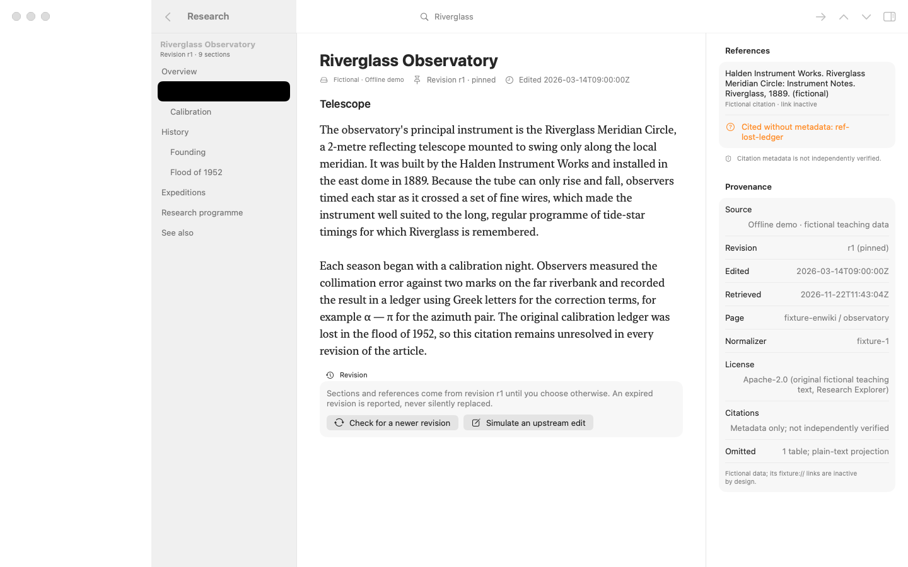

# Swift MCP Examples

**Research Explorer — real MCP, visible from the reading experience to the wire.**

A native macOS research app and a runnable, inspectable example of
[Swift-MCP-Server](https://github.com/ThorFuchs/Swift-MCP-Server) and
[Swift-MCP-Server-HTTP](https://github.com/ThorFuchs/Swift-MCP-Server-HTTP).
Read an article, inspect its sources and exact revision, then follow the same four
read-only tools through a genuine MCP client/server exchange.

> **Pre-release example, not a production MCP hosting service.** macOS 27+, Swift 6.4, Swift 6 language mode.
> Core/HTTP SDK release qualification is ongoing. Standalone Examples macOS CI still needs native
> qualification; the latest Examples CI proved the manifest leg only (the macOS leg was skipped).
> See the [product specification](Docs/RELEASE_1_0_SPEC.md) and [Track C plan](Docs/TRACK_C_SHOWCASE.md).



*Actual RE-03 review capture from the native view on macOS 27, showing fictional offline
Riverglass material. Window-server chrome and some selection materials are not captured by
this snapshot method. [Screenshot details and limitations](Docs/Screenshots/RE-03/README.md).*

## Two ways in

### Explore the research experience

Run the macOS app. First launch selects **Offline demo**, with no outbound network
request and no started listener. Choose **Explore the offline collection** for a guided tour
through five fictional Riverglass articles. Search, choose a result, read a section, and
inspect associated references and provenance. A revised article remains tied to the
selected snapshot unless you explicitly request a comparison.

**Wikipedia English** is a separate, explicitly selected live source. An error in the
live source never silently substitutes fictional content. The plain-text reader is
deliberately not a remote HTML renderer, and citation metadata is not independent
citation verification.

### Follow the real MCP exchange

In the app's **Server** workspace, explicitly start the *loopback-only* development
server and choose **Explore MCP**. The SDK's real HTTP client discovers the server,
lists tools, and calls them over the network stack. The **Activity** workspace counts
eligible real tool-handler calls; direct local research does not fabricate network
traffic. The app does not start a listener by itself.

Prefer the terminal? `--mcp-client` launches a real stdio child, discovers and
invokes the four tools, then closes and joins the child. `--walkthrough` is
intentionally different: it calls the domain service **directly, not via MCP**.

## Run it

The following commands run from this repository root:

```bash
# Native macOS research application (offline by default)
swift run ResearchExplorerApp

# Real MCP server over stdio, using fictional offline Riverglass data
swift run research-explorer --stdio

# Real MCP client that launches and talks to its own stdio child
swift run research-explorer --mcp-client

# Human-readable in-process walkthrough (DIRECT, not MCP)
swift run research-explorer --walkthrough
```

The standalone package currently follows the pre-release Core and HTTP `main`
branches. Reproducibility for an eventual published app requires immutable
released SDK versions; this is a tracked release gate, not a promise about
today's dependency graph.

## Four tools, one revision-bound source

| MCP tool | What it demonstrates |
| --- | --- |
| `search_articles` | Discover bounded candidate results |
| `get_article_outline` | Pin one article revision and retrieve its section structure |
| `read_article_section` | Read the selected section from that same immutable snapshot |
| `get_section_references` | Retrieve references associated with that exact section |

The example uses structured results and the public SDK's validation path.
A snapshot identity ties outline, section and references together; expiration
or unavailable reference data is reported rather than replaced invisibly.

## For developers

This is not a simulated JSON-RPC storyboard. The stdio and HTTP demos use the
public MCP Server/Client SDKs. The in-process walkthrough is labeled as such.

```bash
# Build the executable and run the Examples test suite on macOS
Scripts/test.sh

# Compile the native app
swift build --product ResearchExplorerApp
```

The independent macOS test/packaging gate is being qualified separately from
the Core and HTTP SDK release tracks. A successful Linux *manifest* job alone
does not establish a working packaged macOS app.

Explore the [architecture](Docs/ARCHITECTURE.md),
[live-source safety contract](Docs/LIVE_CONTRACT.md),
[fictional offline collection](Docs/OFFLINE_COLLECTION.md),
[product specification](Docs/RELEASE_1_0_SPEC.md), and
[Track C developer showcase plan](Docs/TRACK_C_SHOWCASE.md).

## Status and provenance

The current standalone Examples checkout was extracted from a verified Core
RE-03 source snapshot. Newer Core RE-04 exchange-inspector/connection-recipe
changes are **not yet integrated here**. They will be synchronized and tested
in a separate PR before the README claims them as shipped functionality.

The app presents original fictional Riverglass demo data and, when explicitly
chosen, content from Wikipedia English. This is an independent example, with
**no official Wikimedia or Apple endorsement**. Code and fictional fixtures
are Apache-2.0; actual Wikipedia content retains its own license and attribution.
See [third-party notices](THIRD_PARTY_NOTICES.md) and
[extraction provenance](MIGRATION.md).

**The goal:** make the research pleasant to use and the SDK behavior easy to verify.
